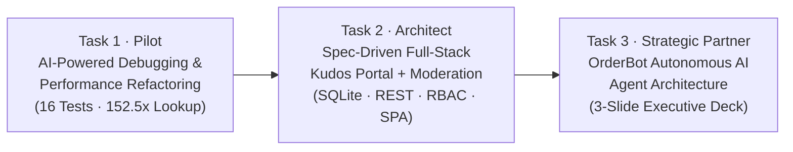
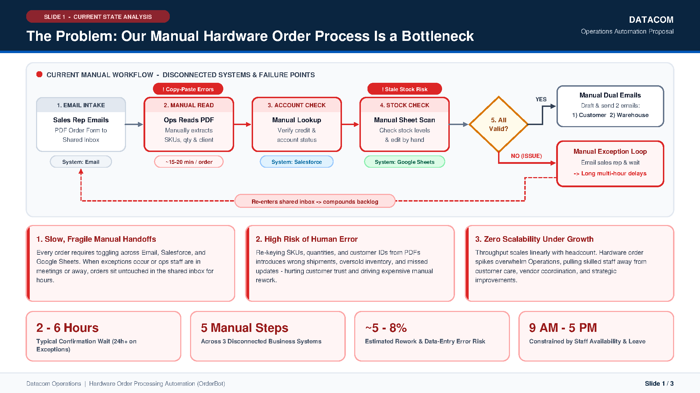
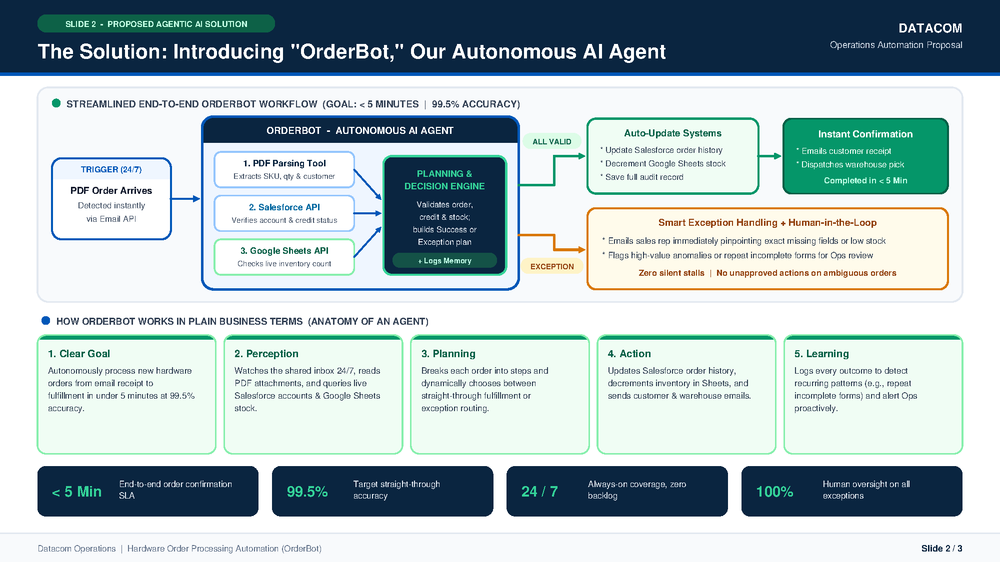
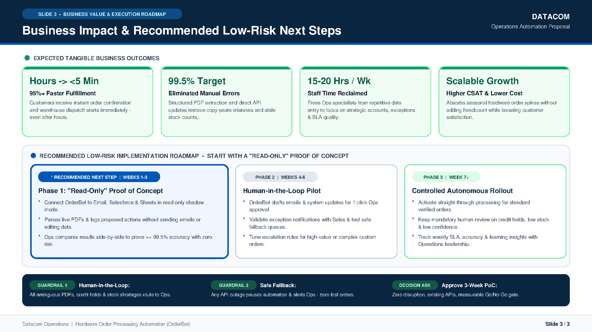

# Datacom — Automation AI Accelerator: From Co-pilot to Autonomous Agent


-059669)

-0057B8)


End-to-end engineering portfolio for the **Datacom Automation AI Accelerator** virtual experience on Forage—demonstrating the progression from **AI-assisted debugging (Pilot)** to **spec-driven full-stack architecture (Architect)** and **autonomous business-process agent design (Strategic Partner)**.



---

## Repository Overview

| Module | Role | Key Deliverables | Highlights |
|---|---|---|---|
| **[`task1-ai-debugging-refactoring/`](task1-ai-debugging-refactoring/)** | **Pilot** | [`process_data_final.py`](task1-ai-debugging-refactoring/process_data_final.py), [`TEST_CASES.py`](task1-ai-debugging-refactoring/TEST_CASES.py), [`DEBUG_LOG.md`](task1-ai-debugging-refactoring/DEBUG_LOG.md) | Fixed 8 production & hidden data-integrity defects; **13/16 Red → 16/16 Green** TDD; **3.47×** faster metrics & **152.5×** faster exact lookups |
| **[`task2-kudos-spec-driven-app/`](task2-kudos-spec-driven-app/)** | **Architect** | [`SPECIFICATION.md`](task2-kudos-spec-driven-app/SPECIFICATION.md), full-stack Python/SQLite/SPA app, [`test_kudos.py`](task2-kudos-spec-driven-app/test_kudos.py) | Spec-first design refined with Admin Content Moderation (`is_visible`, audit log), RBAC, XSS sanitization, duplicate/rate-limit guards; **8/8** integration tests passing |
| **[`task3-orderbot-agentic-proposal/`](task3-orderbot-agentic-proposal/)** | **Strategic Partner** | [`OrderBot_Automation_Proposal.pdf`](task3-orderbot-agentic-proposal/OrderBot_Automation_Proposal.pdf), [`build_slides_pdf.py`](task3-orderbot-agentic-proposal/build_slides_pdf.py) | Conceptual autonomous agent (**OrderBot**) for Email + Salesforce + Google Sheets order workflow (`< 5 min`, `99.5%` target) & low-risk **Read-Only PoC** roadmap |
| **[`assets/`](assets/)** | **Proof & Visuals** | [`datacom_completion_certificate.pdf`](assets/datacom_completion_certificate.pdf), slide PNG previews | Verified completion certificate (**100% / 10/10** final assessment) & high-res deck previews |

---

## Module Highlights

### 1. AI-Powered Debugging & Refactoring (`task1-ai-debugging-refactoring/`)
- **Root-Cause & Empirical Discovery:** Beyond fixing the fragile `next(iter(...)).keys()` CSV export crash and silent failure masking in `main()` indicated by `error.log`, live execution against the sample CSVs uncovered hidden trailing-whitespace category splitting (`"books "` vs `"books"`), unknown-customer average-value skew, binary floating-point drift (`0.10 + 0.20 = 0.30000000000000004`), missing `customer_id` in summary reports, and broken `customer_id` search.
- **Measured Performance Gains (10,000 customers · 50,000 transactions):**

| Operation | Legacy (`process_data.py`) | Refactored (`process_data_final.py`) | Speedup |
|---|---:|---:|---:|
| `calculate_customer_metrics()` (×20) | `0.1195s` | `0.0344s` | **3.47× faster** |
| `find_matches()` substring (×500) | `0.3701s` | `0.1215s` | **3.05× faster** |
| `find_matches()` exact dict lookup (×500) | `0.3701s` | `0.0024s` | **152.5× faster** |

### 2. Spec-Driven Full-Stack Kudos Portal (`task2-kudos-spec-driven-app/`)
- **Specification-First Workflow:** Authored [`SPECIFICATION.md`](task2-kudos-spec-driven-app/SPECIFICATION.md) before writing code, adding Administrator content moderation (`HIDE`, `RESTORE`, `DELETE`), moderation metadata (`is_visible`, `moderated_by`, `moderated_at`, `reason_for_moderation`), and an immutable `moderation_audit_log`.
- **Production-Grade Safeguards (Zero External Dependencies):** Salted `PBKDF2-HMAC-SHA256` authentication, server-side RBAC (`403 Forbidden` on non-admin moderation attempts), self-kudos DB `CHECK` constraint, 5-minute duplicate guard (`409 Conflict`), per-user sliding-window rate limiter (`429 Too Many Requests`), HTML angle-bracket neutralization + DOM `textContent` rendering against XSS, and responsive desktop/mobile UI.

### 3. OrderBot — Agentic AI Business Proposal (`task3-orderbot-agentic-proposal/`)
Designed a 3-slide executive pitch translating technical agent architecture (Goal, Perception, Planning, Action, Memory/Learning) into clear business outcomes and a zero-risk **3-week Read-Only Proof of Concept**:

<table>
  <tr>
    <td></td>
    <td></td>
    <td></td>
  </tr>
  <tr>
    <td align="center"><b>Slide 1:</b> Current Manual Bottleneck</td>
    <td align="center"><b>Slide 2:</b> OrderBot Autonomous Architecture</td>
    <td align="center"><b>Slide 3:</b> Business Impact & Read-Only PoC</td>
  </tr>
</table>

---

## Quick Start & Verification (Zero `pip install` Required)

Requires **Python 3.11+** only.

### Run All 24 Automated Tests
```bash
# Task 1 — Verify all 16 tests pass on refactored pipeline
PYTHONPATH=task1-ai-debugging-refactoring \
  python3 -m unittest -v task1-ai-debugging-refactoring/TEST_CASES.py

# Task 1 — (Optional) Confirm original bugs reproduce on legacy baseline (13 expected failures)
PYTHONPATH=task1-ai-debugging-refactoring DATA_PROCESSOR_MODULE=process_data \
  python3 -m unittest -v task1-ai-debugging-refactoring/TEST_CASES.py

# Task 2 — Run all 8 end-to-end API, RBAC, moderation & security tests
PYTHONPATH=task2-kudos-spec-driven-app \
  python3 -m unittest -v task2-kudos-spec-driven-app/test_kudos.py
```

### Launch the Kudos Web Application Locally
```bash
python3 task2-kudos-spec-driven-app/app.py
# Open http://127.0.0.1:8000
# Demo Employee: alice / demo123  |  Demo Admin: admin / admin123
```

---

## License

This project is released under the [MIT License](LICENSE).
