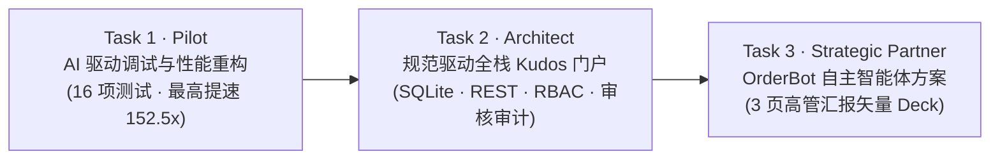
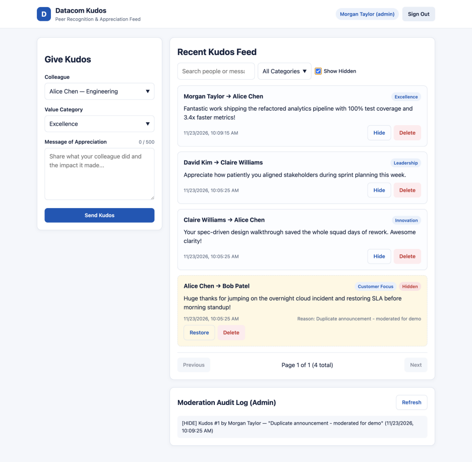
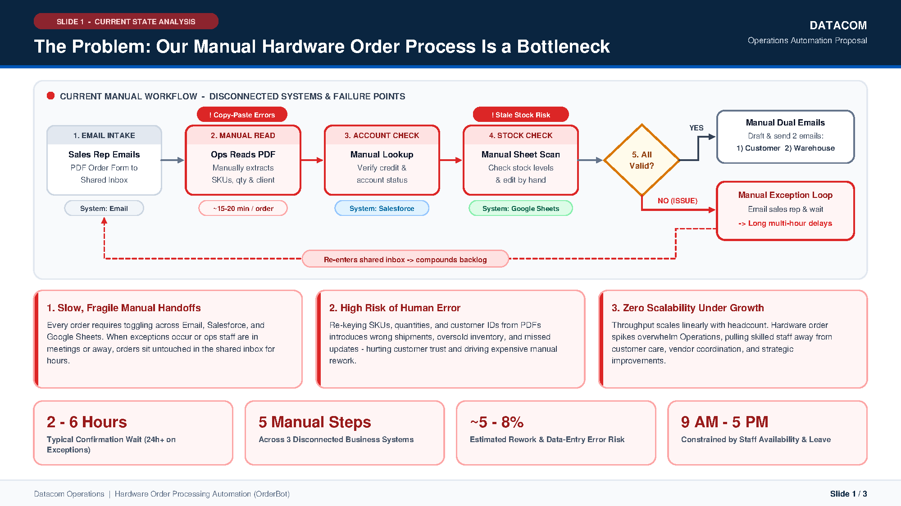
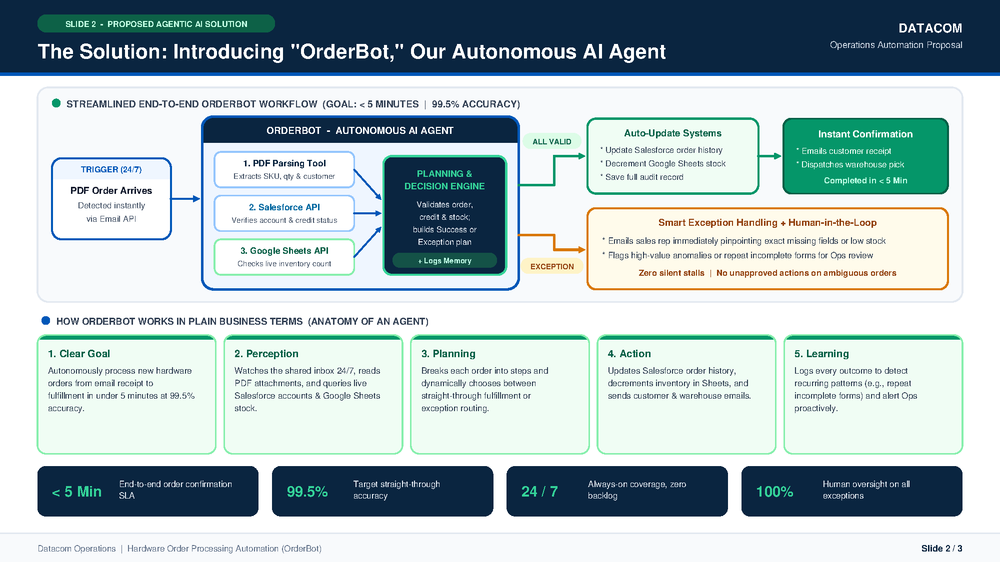
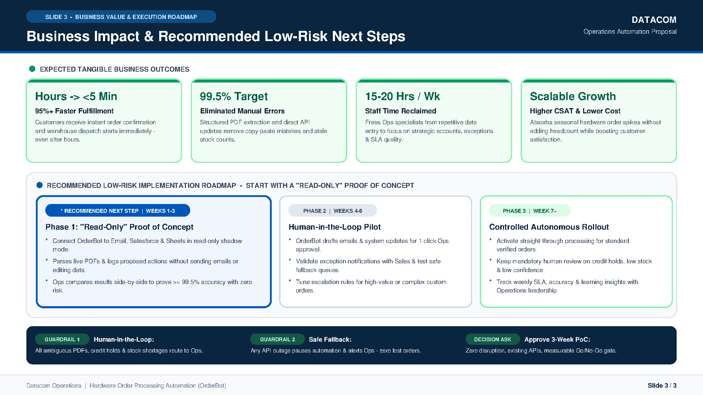

# Datacom — Automation AI Accelerator：从 AI 副驾驶到自主智能体

<p align="left">
  <a href="README.md">English</a> | <strong>简体中文</strong>
</p>

[](https://github.com/Shadows-Zed/datacom-automation-ai-accelerator/actions/workflows/ci.yml)

-059669)

-0057B8)


本项目为 **Datacom Automation AI Accelerator（Forage Job Simulation）** 的完整端到端工程作品集，系统展示了现代工程师在 AI 工作流中的三重进阶：**AI 协作调试与性能优化（Pilot）→ 规范驱动全栈开发（Architect）→ 自主业务流程智能体架构提案（Strategic Partner）**。



---

## 仓库总览

| 模块 | 角色定位 | 核心交付物 | 工程亮点 |
|---|---|---|---|
| **[`task1-ai-debugging-refactoring/`](task1-ai-debugging-refactoring/)** | **Pilot（副驾驶协作）** | [`process_data_final.py`](task1-ai-debugging-refactoring/process_data_final.py)、[`TEST_CASES.py`](task1-ai-debugging-refactoring/TEST_CASES.py)、[`DEBUG_LOG.md`](task1-ai-debugging-refactoring/DEBUG_LOG.md) | 修复 8 类生产及隐藏数据 Bug；**13/16 Red → 16/16 Green** TDD 闭环；指标计算提速 **3.47×**，精确查询提速 **152.5×** |
| **[`task2-kudos-spec-driven-app/`](task2-kudos-spec-driven-app/)** | **Architect（架构师）** | [`SPECIFICATION.md`](task2-kudos-spec-driven-app/SPECIFICATION.md)、零依赖 Python/SQLite/SPA 全栈应用、[`test_kudos.py`](task2-kudos-spec-driven-app/test_kudos.py) | 规范先行并主动补全管理员内容审核（`is_visible` 与审计日志）、RBAC 鉴权、XSS 防护、防重复与限流；**8/8** 端到端测试通过 |
| **[`task3-orderbot-agentic-proposal/`](task3-orderbot-agentic-proposal/)** | **Strategic Partner** | [`OrderBot_Automation_Proposal.pdf`](task3-orderbot-agentic-proposal/OrderBot_Automation_Proposal.pdf)、[`build_slides_pdf.py`](task3-orderbot-agentic-proposal/build_slides_pdf.py) | 面向 Email + Salesforce + Google Sheets 订单流程设计自主智能体 **OrderBot**（`< 5 min` / `99.5%` 准确率）与零风险 **只读 PoC** 路线图 |
| **[`scripts/run_all_checks.py`](scripts/run_all_checks.py)** | **自动化验证** | 一键全量校验与性能跑分脚本 | 单条命令跑完 Task 1 Red→Green、Task 2 集成测试、Task 3 语法检查与 1 万客户/5 万交易基准对比 |
| **[`assets/`](assets/)** | **证书与视觉素材** | [`datacom_completion_certificate.pdf`](assets/datacom_completion_certificate.pdf)、界面与 PPT 高清预览图 | 结业证书（最终测评 **100% / 10/10**）与全套可视化展示图 |

---

## 核心模块详解

### 1. AI 驱动的遗留系统调试与性能优化（`task1-ai-debugging-refactoring/`）
- **实证排障，不止停留在日志表面**：除解决 `error.log` 暴露的 `export_customer_data()` 脆弱 `.keys()` 调用崩溃与 `main()` 静默吞错误问题外，通过实跑样本 CSV 额外挖出并修复了 6 个隐藏数据缺陷：`"books "` 尾随空格导致分类分裂、未知客户交易拉低客单价、浮点精度漂移（`0.10 + 0.20 = 0.30000000000000004`）、`customer_summary.json` 丢失 `customer_id`、`find_matches(..., field="customer_id")` 查询失效以及单行脏金额中断整批任务。
- **10,000 客户 / 50,000 交易实测性能对比**：

| 操作 | 原始脚本 (`process_data.py`) | 重构版本 (`process_data_final.py`) | 性能提升 |
|---|---:|---:|---:|
| `calculate_customer_metrics()`（×20 次） | `0.1195s` | `0.0344s` | **提速 3.47×** |
| `find_matches()` 子串搜索（×500 次） | `0.3701s` | `0.1215s` | **提速 3.05×** |
| `find_matches()` 精确字典查询（×500 次） | `0.3701s` | `0.0024s` | **提速 152.5×** |

### 2. 规范驱动的全栈员工赞赏门户 Kudos（`task2-kudos-spec-driven-app/`）
- **Specification First（先规范、后编码）**：在写代码前先审定 [`SPECIFICATION.md`](task2-kudos-spec-driven-app/SPECIFICATION.md)，并以 Architect 视角补齐了**管理员内容审核（隐藏 / 恢复 / 永久删除 + 必填审核原因）**、`kudos` 表审核扩展字段（`is_visible`、`moderated_by`、`moderated_at`、`reason_for_moderation`）以及不可篡改的 `moderation_audit_log` 审计表。
- **零外部依赖的生产级安全与容错**：加盐 `PBKDF2-HMAC-SHA256` 密码哈希、服务端 RBAC 拦截（非管理员访问审核接口返回 `403 Forbidden`）、数据库 `CHECK` 约束禁止给自己发 Kudos、5 分钟防重复提交（`409 Conflict`）、每用户滑动窗口限流（`429 Too Many Requests`）、防 XSS 尖括号转义 + 前端纯 `textContent` 渲染与响应式双端布局。

<p align="center">
  
  <br />
  <em>Kudos 门户真实运行界面（管理员视角）：左侧同事赞赏表单、右侧实时动态流、带原因标注的已隐藏审核卡片与底部不可篡改审计日志</em>
</p>

### 3. OrderBot — 自主智能体业务流程自动化提案（`task3-orderbot-agentic-proposal/`）
针对横跨 Email、Salesforce 与 Google Sheets 的人工硬件订单处理瓶颈，设计了 **OrderBot** 自主智能体概念架构，并输出 3 页高管汇报级 16:9 纯矢量演示文稿（红/绿痛点方案对比 + **3 周只读影子模式 PoC** 低风险落地路线图）：

<table>
  <tr>
    <td></td>
    <td></td>
    <td></td>
  </tr>
  <tr>
    <td align="center"><b>Slide 1：</b>现状手工流程与瓶颈</td>
    <td align="center"><b>Slide 2：</b>OrderBot 自主智能体架构</td>
    <td align="center"><b>Slide 3：</b>量化收益与低风险只读 PoC</td>
  </tr>
</table>

---

## 关键工程决策与权衡（Design Trade-offs）

- **基于基准测试的二次人工调优（`Decimal` vs. `math.fsum`）**：Task 1 初次基准测试发现 `calculate_customer_metrics()` 内高频执行 `Decimal(str(...))` 限制了吞吐；保留交易累加阶段的 `Decimal` 精确计算，并在聚合查询改用 C 语言实现的 Shewchuk 精确求和（`math.fsum`）后，指标计算提速从 **1.44× 跃升至 3.47×** 且零精度损失。
- **传输层解耦的 HTTP 路由（`KudosApp`）**：Task 2 将 HTTP 路由与业务分发（`KudosApp.handle`）同 TCP Socket 适配器（`KudosHTTPServer`）彻底解耦，使得 8 项端到端 API / RBAC / 限流测试无需抢占端口即可在 1 秒内稳定跑通，也便于未来无缝迁移至 WSGI/ASGI。
- **零第三方运行时依赖**：全仓库仅依赖 Python 3.11+ 标准库与 SQLite（WAL 模式），任何面试官或 CI 节点克隆后无需 `pip install` 即可一键跑通全部 24 项测试并启动 Web 应用。
- **风险前置的渐进式上线策略（Read-Only PoC）**：Task 3 拒绝“一步到位全自动写库”，先通过 3 周只读影子模式在不发邮件、不改生产数据的前提下验证 `≥ 99.5%` 准确率，并在异常场景强制保留 Human-in-the-Loop。

---

## 快速验证与本地运行（无需 `pip install`）

仅需 **Python 3.11+**。

### 一键运行全量校验与性能跑分
```bash
python3 scripts/run_all_checks.py
```

### 分模块运行测试
```bash
# Task 1 — 验证重构版全部 16 项单元测试与 SLA 压测通过
PYTHONPATH=task1-ai-debugging-refactoring \
  python3 -m unittest -v task1-ai-debugging-refactoring/TEST_CASES.py

# Task 1 — （可选）对原始脚本运行同一套测试，复现 13 项原始故障（Red 阶段）
PYTHONPATH=task1-ai-debugging-refactoring DATA_PROCESSOR_MODULE=process_data \
  python3 -m unittest -v task1-ai-debugging-refactoring/TEST_CASES.py

# Task 2 — 运行全部 8 项 Kudos API、RBAC、内容审核与防刷屏测试
PYTHONPATH=task2-kudos-spec-driven-app \
  python3 -m unittest -v task2-kudos-spec-driven-app/test_kudos.py
```

### 本地启动 Kudos 全栈应用
```bash
python3 task2-kudos-spec-driven-app/app.py
# 浏览器打开 http://127.0.0.1:8000
# 演示员工账号：alice / demo123  |  演示管理员账号：admin / admin123
```

---

## 开源协议

本项目基于 [MIT License](LICENSE) 开源。
