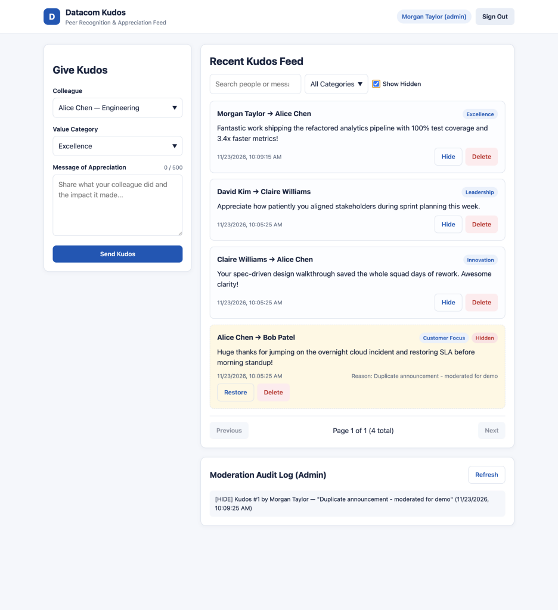

# Datacom Kudos Portal (Task 2 — Spec-Driven Development)

An internal employee peer-recognition ("Kudos") web application built from scratch using a **Spec-Driven Development** workflow. See [SPECIFICATION.md](SPECIFICATION.md) for the complete approved requirements, database schema (including content moderation fields), REST API contract, security design, and architect reflection.

## Features

- **Authentication & RBAC:** Session-token authentication with salted PBKDF2-HMAC-SHA256 password hashing and server-enforced `employee` / `admin` roles.
- **Give Kudos:** Select a colleague (excluding yourself), choose a company value category, and submit a 1–500 character appreciation message.
- **Public Dashboard Feed:** Paginated newest-first feed of visible kudos with category filtering and search.
- **Admin Content Moderation:** Administrators can **hide** (`is_visible = false`), **restore**, or **permanently delete** inappropriate kudos with mandatory moderation reasons and an immutable `moderation_audit_log`.
- **Abuse & Security Protections:** Self-kudos prevention, 5-minute duplicate guard (`409 Conflict`), per-user spam rate limiting (`429 Too Many Requests`), HTML angle-bracket neutralization + DOM `textContent` rendering against XSS, and parameterized SQLite queries.

## Live UI Preview



## Quick Start (Zero External Dependencies)

Requires Python 3.10+.

```bash
python3 app.py
```

Open `http://127.0.0.1:8000` in your browser.

### Demo Accounts
| Role | Username | Password |
|---|---|---|
| Employee | `alice` | `demo123` |
| Employee | `bob` | `demo123` |
| Administrator | `admin` | `admin123` |

## Running Automated Tests

```bash
python3 -m unittest -v test_kudos.py
```

## Project Structure

```text
task2-kudos-spec-driven-app/
├── SPECIFICATION.md      # Approved functional requirements, schema, API spec & reflection
├── app.py                # Application entrypoint
├── server.py             # Threaded HTTP REST API & static asset server
├── service.py            # Kudos business logic, validation, moderation & rate limiting
├── auth.py               # Password hashing, session management & RBAC
├── db.py                 # SQLite schema, indexes & demo seed data
├── test_kudos.py         # Automated unit & end-to-end HTTP integration tests
└── static/
    ├── index.html        # Responsive SPA markup
    ├── styles.css        # Responsive desktop/tablet/mobile styling
    └── app.js            # Frontend state & API client
```
