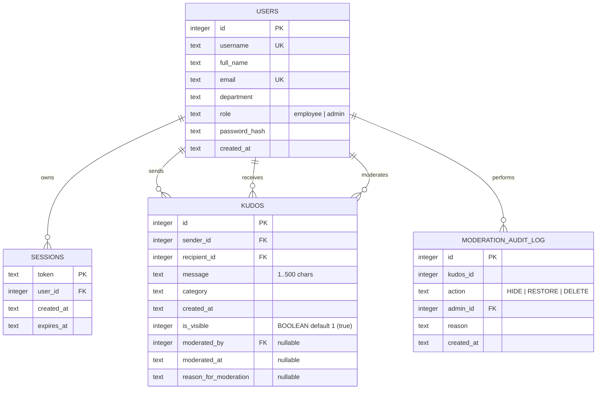

# Kudos System Specification (`SPECIFICATION.md`)

**Project:** Datacom Internal Employee Portal — Peer Recognition ("Kudos") Feature  
**Methodology:** Spec-Driven Development (Specification First, Human-in-the-Loop Architecture Review)  
**Author Role:** Graduate Developer / AI Architect  
**Status:** Approved for Implementation (v2.0 — Post-Architect Moderation Refinement)

---

## 1. Executive Summary & Architect Refinement Log

### Initial Stakeholder Prompt (v1.0)
> *"Create a feature for our internal web app that allows users to give 'kudos' to their colleagues. A user should be able to select another user from a list, write a short message of appreciation, and submit it. There should also be a public feed on the main dashboard where all recently submitted kudos are visible."*

### Architect Review & Refinements Added Before Implementation (v1.0 → v2.0)
Before approving code generation, the Architect reviewed the initial AI specification and identified critical production gaps:
1. **Added Content Moderation (Requirements):** Added dedicated Administrator user stories (`US-5`, `US-6`) to **hide** (`is_visible = false`), **restore**, or **permanently delete** inappropriate kudos messages with a mandatory moderation reason and immutable audit log.
2. **Updated Database Schema (Design):** Extended the `kudos` table with `is_visible` (boolean, default `true`), `moderated_by` (FK → `users.id`), `moderated_at` (ISO-8601 timestamp), and `reason_for_moderation` (text), and added a `moderation_audit_log` table for compliance traceability.
3. **Added Abuse & Edge-Case Protections:** Defined explicit guards for self-kudos prevention (`sender_id != recipient_id`), duplicate-submission throttling (same sender + recipient + message within 5 minutes), per-user spam rate limiting (max 5 kudos per minute), strict 500-character limits, and XSS output sanitization.

---

## 2. Functional Requirements

### 2.1 User Stories

| ID | Role | User Story | Priority |
|---|---|---|---|
| **US-1** | Employee / Admin | As an employee, I can log in with my credentials so that kudos are attributed to my verified identity and admin features are protected by role-based access control. | Must Have |
| **US-2** | Employee | As a user, I can select another colleague from a list (excluding myself) so that I can direct my appreciation to the right teammate. | Must Have |
| **US-3** | Employee | As a user, I can write a message of appreciation (1–500 characters) with an optional category and submit it so that it is persisted in the database. | Must Have |
| **US-4** | Employee | As a user, I can view a paginated public feed of recently submitted visible kudos on the main dashboard, optionally filtered by category or search term. | Must Have |
| **US-5** | Administrator | As an administrator, I can hide (`is_visible = false`), restore (`is_visible = true`), or permanently delete inappropriate kudos messages while recording a moderation reason. | Must Have *(Architect Addition)* |
| **US-6** | Administrator | As an administrator, I can view hidden kudos and a moderation audit log so that moderation actions remain transparent and auditable. | Should Have *(Architect Addition)* |
| **US-7** | Employee / Admin | As a user on desktop, tablet, or mobile, I can comfortably submit kudos and browse the feed through a responsive interface with clear validation feedback. | Must Have |

### 2.2 Acceptance Criteria

- **US-1 (Authentication & Authorization):**
  - Valid credentials return an authenticated session token (`200 OK`) and user profile (`id`, `username`, `full_name`, `department`, `role`).
  - Invalid credentials return `401 Unauthorized` with a generic error message (no user enumeration).
  - Unauthenticated write/admin requests return `401 Unauthorized`.
  - Non-admin users attempting any `/api/admin/*` endpoint or requesting hidden kudos receive `403 Forbidden`.
- **US-2 (Colleague Selection):**
  - `GET /api/users` returns all colleagues sorted alphabetically by `full_name`.
  - The UI colleague selector excludes the currently logged-in user; the backend also enforces `sender_id != recipient_id` (`400 Bad Request` if violated).
  - Submitting a kudos to a non-existent `recipient_id` returns `404 Not Found`.
- **US-3 (Kudos Creation & Edge-Case Guards):**
  - Empty or whitespace-only messages are rejected (`400 Bad Request`).
  - Messages exceeding 500 characters are rejected (`400 Bad Request`) and blocked in the UI with a live character counter (`0 / 500`).
  - Duplicate submissions (same `sender_id`, `recipient_id`, and normalized `message` within 5 minutes) are rejected (`409 Conflict`).
  - Spam rate limit: more than 5 kudos submitted by the same user within a rolling 60-second window returns `429 Too Many Requests`.
  - HTML/script payloads (e.g., `<script>alert(1)</script>`) are sanitized/escaped so executable markup never renders in the browser.
- **US-4 (Public Feed):**
  - `GET /api/kudos` returns only records with `is_visible = 1`, ordered by `created_at DESC, id DESC`.
  - Supports pagination (`page`, `page_size` default 10, max 50) returning `items`, `total`, `page`, `page_size`, and `has_more`.
  - Supports optional `category` and case-insensitive `search` filtering.
- **US-5 & US-6 (Content Moderation — Architect Addition):**
  - `PATCH /api/admin/kudos/{id}/visibility` toggles `is_visible` (`false` to hide, `true` to restore), records `moderated_by`, `moderated_at`, and `reason_for_moderation` (required when hiding, min 3 chars), and appends an entry to `moderation_audit_log`.
  - Hidden kudos immediately disappear from the public feed (`GET /api/kudos`) while remaining accessible to admins (`GET /api/kudos?include_hidden=true`).
  - `DELETE /api/admin/kudos/{id}` permanently removes the kudos record and logs a `DELETE` entry in `moderation_audit_log`.
- **US-7 (Responsive Design & Error Handling):**
  - Two-column desktop layout (composer + feed) collapses cleanly to a single-column stack below `768px`.
  - Inline validation messages and toast notifications communicate success, validation errors, rate limits, and network failures clearly.

---

## 3. Technical Design

### 3.1 Architecture & Stack Choice
- **Backend:** Python 3.12 REST API (`http.server.ThreadingHTTPServer` + clean modular service/repository layers) — zero third-party runtime dependencies for deterministic execution.
- **Database:** SQLite 3 (`WAL` journal mode, `PRAGMA foreign_keys = ON`) with clean ANSI-compatible SQL DDL easily portable to PostgreSQL in production.
- **Frontend:** Responsive HTML5 / CSS3 / Vanilla ES6 Single-Page Application served from `/static/` with strict DOM text rendering (`textContent`) to prevent DOM-based XSS.

### 3.2 Database Schema



#### SQL DDL Summary
```sql
CREATE TABLE IF NOT EXISTS users (
    id INTEGER PRIMARY KEY AUTOINCREMENT,
    username TEXT NOT NULL UNIQUE,
    full_name TEXT NOT NULL,
    email TEXT NOT NULL UNIQUE,
    department TEXT NOT NULL,
    role TEXT NOT NULL CHECK (role IN ('employee', 'admin')) DEFAULT 'employee',
    password_hash TEXT NOT NULL,
    created_at TEXT NOT NULL
);

CREATE TABLE IF NOT EXISTS sessions (
    token TEXT PRIMARY KEY,
    user_id INTEGER NOT NULL,
    created_at TEXT NOT NULL,
    expires_at TEXT NOT NULL,
    FOREIGN KEY (user_id) REFERENCES users(id) ON DELETE CASCADE
);

CREATE TABLE IF NOT EXISTS kudos (
    id INTEGER PRIMARY KEY AUTOINCREMENT,
    sender_id INTEGER NOT NULL,
    recipient_id INTEGER NOT NULL,
    message TEXT NOT NULL CHECK (length(trim(message)) BETWEEN 1 AND 500),
    category TEXT NOT NULL DEFAULT 'Teamwork',
    created_at TEXT NOT NULL,
    is_visible INTEGER NOT NULL DEFAULT 1 CHECK (is_visible IN (0, 1)),
    moderated_by INTEGER,
    moderated_at TEXT,
    reason_for_moderation TEXT,
    CHECK (sender_id != recipient_id),
    FOREIGN KEY (sender_id) REFERENCES users(id) ON DELETE CASCADE,
    FOREIGN KEY (recipient_id) REFERENCES users(id) ON DELETE CASCADE,
    FOREIGN KEY (moderated_by) REFERENCES users(id) ON DELETE SET NULL
);

CREATE TABLE IF NOT EXISTS moderation_audit_log (
    id INTEGER PRIMARY KEY AUTOINCREMENT,
    kudos_id INTEGER NOT NULL,
    action TEXT NOT NULL CHECK (action IN ('HIDE', 'RESTORE', 'DELETE')),
    admin_id INTEGER NOT NULL,
    reason TEXT NOT NULL,
    created_at TEXT NOT NULL,
    FOREIGN KEY (admin_id) REFERENCES users(id) ON DELETE CASCADE
);

CREATE INDEX IF NOT EXISTS idx_kudos_visible_created
    ON kudos (is_visible, created_at DESC, id DESC);
CREATE INDEX IF NOT EXISTS idx_kudos_sender_created
    ON kudos (sender_id, created_at DESC);
CREATE INDEX IF NOT EXISTS idx_kudos_recipient
    ON kudos (recipient_id);
```

### 3.3 REST API Endpoints

| Method & Path | Auth / Role | Request Parameters / Body | Success Response | Error Codes |
|---|---|---|---|---|
| `GET /api/health` | Public | None | `200` `{"status": "ok", "timestamp": "..."}` | `500` |
| `POST /api/auth/login` | Public | `{"username": "...", "password": "..."}` | `200` `{"token": "...", "user": {...}}` | `400`, `401` |
| `POST /api/auth/logout` | Authenticated | Header `Authorization: Bearer <token>` | `200` `{"message": "Logged out"}` | `401` |
| `GET /api/auth/me` | Authenticated | Header `Authorization: Bearer <token>` | `200` `{"user": {...}}` | `401` |
| `GET /api/users` | Authenticated | Optional `?exclude_self=true` | `200` `{"users": [...]}` | `401` |
| `GET /api/kudos` | Public (Admin for `include_hidden=true`) | `?page=1&page_size=10&category=&search=&include_hidden=false` | `200` `{"items": [...], "total": N, "page": 1, "page_size": 10, "has_more": bool}` | `400`, `403` |
| `POST /api/kudos` | Authenticated | `{"recipient_id": 2, "message": "...", "category": "Teamwork"}` | `201` `{"kudos": {...}}` | `400`, `401`, `404`, `409`, `429` |
| `PATCH /api/admin/kudos/{id}/visibility` | Admin | `{"is_visible": false, "reason": "Inappropriate language"}` | `200` `{"kudos": {...}}` | `400`, `401`, `403`, `404` |
| `DELETE /api/admin/kudos/{id}` | Admin | Optional `{"reason": "Severe policy violation"}` | `200` `{"deleted_id": id}` | `401`, `403`, `404` |
| `GET /api/admin/audit-logs` | Admin | Optional `?limit=50` | `200` `{"logs": [...]}` | `401`, `403` |

### 3.4 Frontend Component Hierarchy

```text
AppShell
├── HeaderBar (Brand, Current User Badge, Role Pill, Login / Switch User / Logout)
├── AuthBanner / LoginModal (Quick-select demo employee/admin or credentials form)
└── MainGrid (2-column desktop, stacked mobile)
    ├── KudosComposerCard
    │   ├── ColleagueSelectDropdown (excludes current user)
    │   ├── CategoryChipSelector (Teamwork, Innovation, Leadership, Customer Focus)
    │   ├── MessageTextarea + LiveCharacterCounter (0 / 500)
    │   └── SubmitButton + InlineValidationAlert
    └── KudosFeedSection
        ├── FeedToolbar (Search Input, Category Filter, Admin "Show Hidden" Toggle)
        ├── KudosCardList
        │   └── KudosCard (Sender → Recipient, Category Badge, Timestamp, Message,
        │                  Hidden Badge + Reason if moderated, Admin Hide/Restore/Delete Controls)
        ├── PaginationBar (Prev / Page X of Y / Next)
        └── AdminAuditDrawer (Admin-only moderation log view)
```

### 3.5 Security Considerations
- **Password Storage:** Salted `hashlib.pbkdf2_hmac("sha256", ..., 100_000)` with constant-time `hmac.compare_digest` verification.
- **Session Tokens:** Cryptographically random 32-byte URL-safe tokens (`secrets.token_urlsafe(32)`) stored with explicit UTC expiration (`24h`).
- **Role-Based Access Control (RBAC):** Server-side verification on every admin endpoint and `include_hidden=true` query parameter; client UI controls are convenience only.
- **XSS Prevention:** Backend strips/rejects control characters and escapes unsafe HTML on serialization/sanitization boundaries; frontend exclusively renders user-authored text with `element.textContent` (never `innerHTML`).
- **SQL Injection Prevention:** 100% parameterized SQLite queries (`?` placeholders).
- **Anti-Spam & Anti-Duplicate:** Rolling 60-second rate limit (`MAX_KUDOS_PER_MINUTE = 5`) and 5-minute duplicate detection (`DUPLICATE_WINDOW_SECONDS = 300`).

### 3.6 Performance Considerations
- **Composite Indexing:** `idx_kudos_visible_created (is_visible, created_at DESC, id DESC)` allows the public dashboard feed query to satisfy filtering and ordering without full table scans.
- **Pagination:** Bounded `LIMIT`/`OFFSET` pagination (default `10`, capped at `50`) keeps payload sizes small as kudos volume grows.
- **Directory Caching:** `GET /api/users` sends `Cache-Control: private, max-age=60` to avoid redundant colleague-list fetches during active sessions.

### 3.7 Error Handling & Logging Strategy
- **Uniform Error Envelope:** Every error returns JSON: `{"error": {"code": "VALIDATION_ERROR", "message": "..."}}`.
- **Structured Logging:** Timestamped `INFO`/`WARNING`/`ERROR` server logs record authentication failures, rate-limit trips, moderation events, and unexpected exceptions without leaking stack traces or secrets to clients.
- **Moderation Auditability:** Every hide, restore, and delete action writes atomically to `moderation_audit_log` inside the same database transaction as the `kudos` mutation.

---

## 4. Implementation Plan

| Step | Task | Dependencies | Deliverables |
|---|---|---|---|
| **T1** | Define database schema, migrations, connection helper, and seed demo users/kudos | None | `db.py` |
| **T2** | Implement password hashing, session authentication, and RBAC helpers | T1 | `auth.py` |
| **T3** | Implement core Kudos service (validation, XSS sanitization, duplicate guard, rate limiter, pagination, admin moderation + audit log) | T1, T2 | `service.py` |
| **T4** | Build threaded HTTP REST API router & static file server with uniform error handling | T2, T3 | `server.py`, `app.py` |
| **T5** | Build responsive HTML5/CSS3/ES6 frontend dashboard with colleague picker, live counter, feed filters, and Admin Moderation UI | T4 | `static/index.html`, `static/styles.css`, `static/app.js` |
| **T6** | Write comprehensive automated unit & HTTP integration tests covering all user stories, RBAC, moderation, XSS, spam, and edge cases | T1–T4 | `test_kudos.py` |
| **T7** | Run full test suite & end-to-end verification, document usage in `README.md` | T5, T6 | `README.md` |
| **T8** | Initialize Git repository, commit complete codebase + `SPECIFICATION.md`, and prepare repository/archive deliverable | T7 | Git repo + submission package |

### Testing Strategy
- **Service & Database Unit Tests:** Schema constraints (`CHECK` constraints, defaults), validation rules, duplicate window, rate limiting, XSS sanitization, pagination math.
- **RBAC & Moderation Tests:** Verify employee receives `403 Forbidden` on hide/delete/audit endpoints; verify admin hide removes item from public feed, updates `is_visible`, `moderated_by`, `moderated_at`, `reason_for_moderation`, and logs audit trail; verify restore and hard delete.
- **End-to-End HTTP Integration Tests:** Boot the real `ThreadingHTTPServer` on an ephemeral port (`port=0`) and verify full login → list colleagues → post kudos → read public feed → admin moderate → verify feed updated flows over HTTP.

### Deployment Considerations
- Configurable via environment variables (`KUDOS_DB_PATH`, `KUDOS_HOST`, `KUDOS_PORT`).
- `GET /api/health` endpoint supports container liveness/readiness probes.
- For multi-instance production deployment behind a load balancer, swap SQLite for PostgreSQL and move the in-memory sliding-window rate limiter to Redis while keeping the service & API contracts identical.

---

## 5. Architect Reflection

1. **How did the structured approach to specification change the development process compared to traditional coding?**  
   Writing `SPECIFICATION.md` first shifted ambiguity resolution upstream, where changing a table column or endpoint contract takes seconds instead of hours of refactoring across backend, database, and UI code. Every module (`db.py`, `auth.py`, `service.py`, `server.py`, and frontend) mapped cleanly to pre-agreed contracts.

2. **What was the most challenging part of reviewing and refining the AI-generated specification?**  
   Identifying *implicit* operational and governance requirements that were absent from the original one-sentence request — specifically content moderation lifecycle states (soft hide vs. restore vs. permanent delete), auditability (`moderation_audit_log`), and abuse vectors (self-kudos, spam flooding, duplicate double-clicks, and XSS payloads).

3. **How did having a complete specification before implementation affect the quality and completeness of the final code?**  
   Having explicit acceptance criteria, HTTP status codes, and SQL constraints turned implementation and test authoring into a deterministic checklist. Every edge case (such as `409 Conflict` duplicates, `429 Too Many Requests` rate limiting, and `403 Forbidden` RBAC enforcement) was built right the first time and verified with automated tests.
