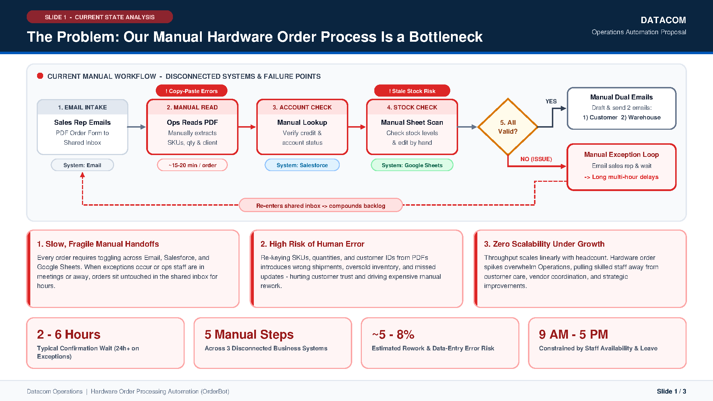
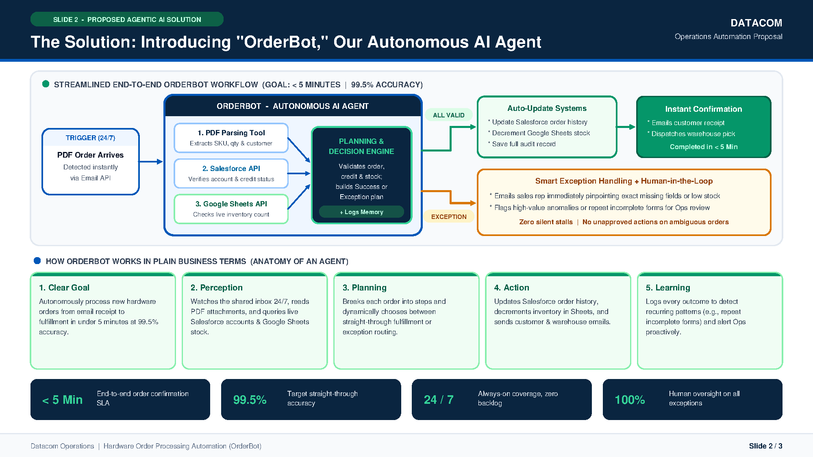
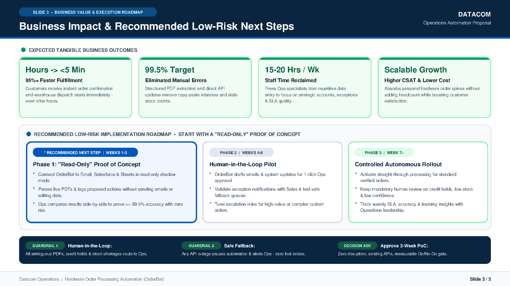

# Task 3: Automating Business Analysis with Agentic AI ("OrderBot")

> **Role:** Strategic Technology Partner (Agentic System Architecture & Executive Proposal)

Analyzed a manual, error-prone hardware order workflow spanning **Email**, **Salesforce**, and **Google Sheets**, and designed **OrderBot**—an autonomous business process agent targeting **< 5 minute** confirmation turnaround at **99.5% accuracy**, paired with a low-risk **Read-Only Proof of Concept** rollout plan.

## Slide Deck Previews

### Slide 1 — The Problem: Current Manual Bottleneck


### Slide 2 — The Solution: Introducing "OrderBot"


### Slide 3 — Business Impact & Low-Risk Next Steps


## Files

- [`OrderBot_Automation_Proposal.pdf`](OrderBot_Automation_Proposal.pdf) — Full 3-slide 16:9 vector executive deck.
- [`build_slides_pdf.py`](build_slides_pdf.py) — Zero-dependency pure Python + Ghostscript generator for reproducing or customizing the vector PDF deck:
  ```bash
  python3 build_slides_pdf.py
  ```
